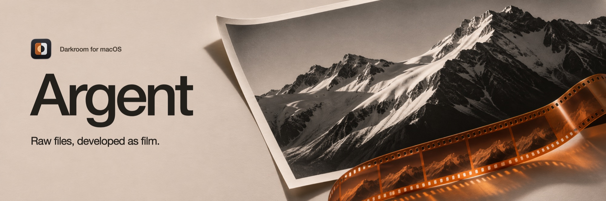

<h1 align="center">
  
</h1>

<p align="center"><strong>A digital roll. A film finish.</strong></p>

<p align="center">
  Native RAW development for Sony a7 IV.<br>
  Modelled colour negative and print. Made for Mac.
</p>

<p align="center">
  <a href="#the-workflow">The workflow</a> ·
  <a href="#build-locally">Build locally</a> ·
  <a href="#documentation">Documentation</a>
</p>

---

Argent turns a folder of RAW files into a roll of finished film-look images. Choose a stock,
let Auto find the print exposure and lab balance, and refine only the frames that need it.
The photograph stays at the centre, in a native SwiftUI interface built around the roll.

**Open source (Apache 2.0) · [Nightly and tagged builds](https://github.com/CyR1en/Argent/releases) · macOS 27 · Apple silicon**

## Film, not a filter

Every frame starts with scene-linear RAW and passes through a modelled colour negative and
print. Grain, halation and capture sharpening use the same renderer in previews and developed
files.

The library offers **14 stocks and print variants**: Portra 160, Portra Natural, Portra 400
and Portra 800; Ektar 100, Gold 200, ColorPlus 200 and UltraMax 400; Pro 400H, C200 and
Superia 400; Tungsten 500, Cinema 500 and Tungsten 800.

Most are based on published Kodak and Fujifilm datasheets. ColorPlus 200 uses Gold 200 as a
proxy; Tungsten 800 uses CineStill's published curves with proxy spectra. None is fitted to
lab scans. Portra Natural reduces Portra 160's couplers to 60% for gentler skin colour,
a rendering choice rather than a measured film. [Inside the film model →](bake/README.md)

## The workflow

1. **Bring in a roll.** Open a folder or import from a card. Review the contact sheet in capture
   order, flag the frames to keep in view, and work with one frame or a selection.
2. **Choose the film.** Set Stock, Rated at and Lab balance for the roll. Auto measures each
   frame and smooths its decisions across the roll. Compare against neutral RAW, then use
   Light, Curve, Masks or Lens when a frame needs more attention. Edits autosave, support
   Undo/Redo, and can be copied between frames.
3. **Develop.** Write the frames shown to JPEG, HEIC or 16-bit TIFF in sRGB, Display P3 or
   Adobe RGB, with EXIF, GPS and XMP metadata. Recipes keep the settings; a stopped develop
   can resume.

Edits leave the source RAW data untouched, and image processing stays on the Mac. Auto is a
starting point, not a guarantee of identical brightness across reframings.

## Build locally

Argent is self-signed, not notarized. [Releases](https://github.com/CyR1en/Argent/releases) carry a disk image
of every `v*` tag and a nightly of `main`, without the smart masks' or Remove's models; the first time a downloaded copy
opens, macOS asks once, in System Settings › Privacy & Security › Open Anyway. To build it yourself:

- **macOS 27** on Apple silicon.
- **Xcode 27** with Swift 6.4; Command Line Tools alone cannot build the app.
- **Python 3.10+** with NumPy for the stock bake tool.

From the repository root:

```sh
python3 -m venv .venv
.venv/bin/pip install numpy pytest
scripts/build-app.sh debug open
```

The script bakes the stock library, builds and signs `build/Argent.app` (ad-hoc unless the keychain holds "Argent Self-Signed"), then opens it.
Import a roll in the app, or open one directly:

```sh
open -a "$PWD/build/Argent.app" /path/to/roll
```

`scripts/build-dmg.sh` packs a release build into `build/Argent-<version>.dmg`, a drag-to-Applications
image with the models `build/Argent.app` holds; `--no-models` leaves them out for a copy that goes to
anyone else. The app is self-signed or ad-hoc, never notarized, so a Mac that downloads it asks once, in System Settings ›
Privacy & Security › Open Anyway.

Smart masks and model-backed Remove need separately converted models. The app builds without
them: Sky and Remove are unavailable, and Subject and Background offer their models as a free,
non-commercial download behind a screen with their licences. See [model setup and licences](scripts/README.md)
before enabling the rest; Remove's weights must not be distributed unless cleared or replaced.

<details>
<summary>Development and validation</summary>

Local checks are the gate. The one hosted workflow, [`.github/workflows/release.yml`](.github/workflows/release.yml), runs
`scripts/build-dmg.sh --no-models` on GitHub's Xcode 27 runner: a push to `main` replaces the `nightly` pre-release, a pushed
`v*` tag (`git tag v0.2.0 && git push origin v0.2.0`) publishes that version, and a pull request keeps the image as a
workflow artifact. It runs no tests. The app's version is the newest `v*` tag and its build number the commit count
(`scripts/build-app.sh`); builds are signed with the self-signed "Argent Self-Signed" certificate when the keychain holds it
(`scripts/sign-identity.sh`), in CI from the `SIGNING_P12` secrets, else ad-hoc.

```sh
swift test
scripts/test-regression-tooling.sh
scripts/fetch-samples.sh && scripts/regression.sh
(cd bake && ../.venv/bin/python -m pytest)
scripts/build-app.sh
```

The full validation pass also verifies the app signature
and runs `BakedStockContractTests` for every baked stock. It covers Xcode selection, fixtures
and opt-in measurement suites.

The command-line spike can develop a roll using a baked stock:

```sh
swift build -c release
.build/release/argent-spike /path/to/roll --stock build/stocks/kodak-portra-400 --out out
```

Without `--stock` it uses a placeholder neutral LUT, not a film look. For stock baking and its
contracts, see [argent-bake](bake/README.md).

</details>

## Documentation

This README, [the stock model](bake/README.md) and [the build and model scripts](scripts/README.md)
are the public documentation.

Argent's design notes, research and records are kept in a separate private repository. Code
comments still cite them by path, such as `docs/provenance.md` or `docs/remove-plan.md`, section 4.5,
so a reader knows where a decision was recorded. They aren't needed to build, run or test the
app. With access, `scripts/docs.sh` clones them into `docs/`.

## Licence

Argent is licensed under the [Apache License 2.0](LICENSE). A few files keep their own terms, the CIE
tables in `bake/argent_bake/data/` (CC BY-SA 4.0) and the Hanken Grotesk font (SIL OFL 1.1), as
[NOTICE](NOTICE) lists. Built with DINOv3. No model weights are in this repository: the optional
Subject models download is offered free for non-commercial use under its own licences (shown before
download), and the conversion scripts download the rest under theirs ([model licences](scripts/models/licences/README.md)).
Constants chosen on research-only data must be refit before any commercial use; [NOTICE](NOTICE)
names them. Film names identify the stocks whose published
data each model follows; Argent is not affiliated with their makers.
